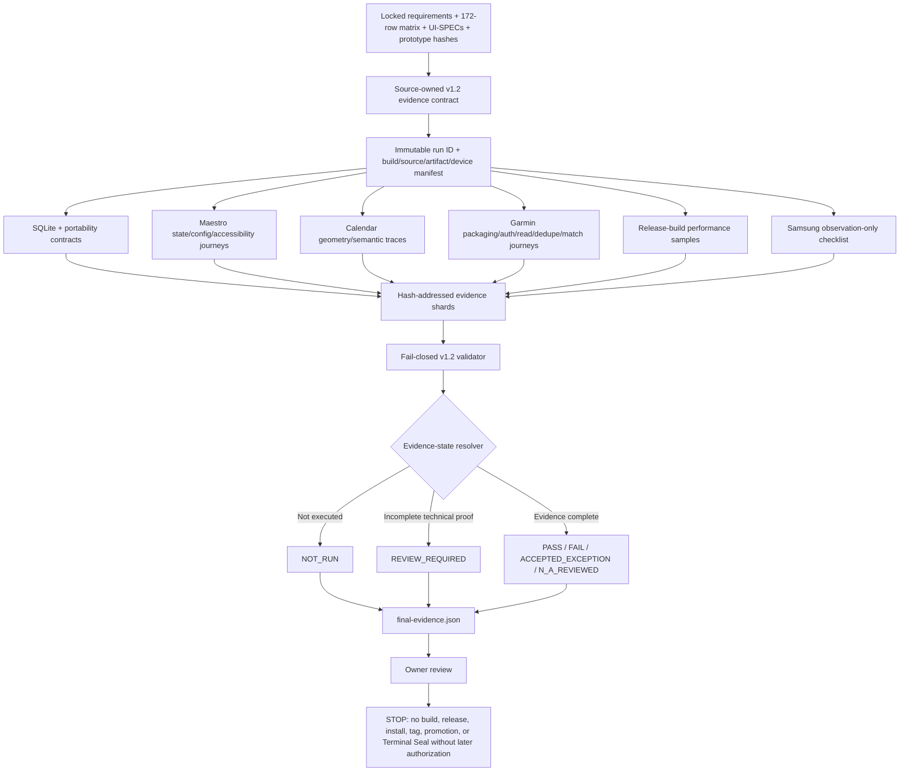

# Phase 20: Native Acceptance - Research

**Researched:** 2026-10-06
**Domain:** Source-bound Android native acceptance, evidence integrity, SQLite/recovery, standalone Garmin JSON sync, Calendar gesture, performance, and attended Samsung observation
**Confidence:** MEDIUM — locked contracts and current repository tooling were inspected directly; no app build, test, emulator, device, import, signing, or release action was run.

<user_constraints>
## User Constraints (from CONTEXT.md)

### Locked Decisions

### Evidence contract
- **D20-01:** Every one of the 172 parity-matrix rows receives source-bound automated/native evidence, plus attended evidence only where the requirement explicitly calls for it; no inherited v1.1 evidence, unexecuted technical path, or fixture-only result impersonates v1.2 proof.
- **D20-02:** Screenshot matrix covers Light/Dark/System; 360×800, 390×844, 600×960, 840×1080-equivalent; portrait/landscape; default/200% text; all material states.
- **D20-03:** Verify >=48dp, non-color state, labels, keyboard/D-pad, visible focus, Back/Escape, focus restoration, reduced motion, and adaptive reading order.
- **D20-04:** Real SQLite tests cover fresh/legacy migration, rollback/retry, backup/restore/merge, process death, offline workout, Garmin JSON sync/match idempotency, and immutable history.
- **D20-05:** Calendar evidence captures intermediate 1:1 drag, both sides of 25%, recede/cancel, short-fast snap-back, expand/collapse/adjacent sequence, and reduced motion.
- **D20-06:** Preserve stricter product budgets: warm interactive <=1s, cold no-migration <=2s, root switch p95 <=100ms, input/rest <=50ms, search-after-debounce <=100ms, Calendar <=250ms, useful Progress <=500ms, review-open <=200ms, set+dock <=150ms, plus bounded Garmin JSON sync/normalization memory evidence.
- **D20-07:** Samsung attended review is acceptance observation in addition to automated proof. No build/release/device action occurs until later owner authorization.

### Settled baselines and evidence verdicts
- **D20-08:** MAP-01, TIM-01, DEV-01, DEV-02, and the bundled Android Python/Chaquopy Garmin transport are settled required baselines. They may PASS after successful implementation evidence; missing proof is NOT_RUN or REVIEW_REQUIRED and observed failure is FAIL. `ACCEPTED_EXCEPTION` is reserved for a later explicit deviation, remains non-PASS, and requires a deviation ID, owner decision/date, exact scope/configurations, rationale, and evidence hashes. Release readiness may be `CONDITIONALLY_READY` only under an explicit reviewed policy when every remaining non-PASS row is such a valid exception.

### Claude's Discretion
- Evidence shard organization and synthetic fixture generation, provided privacy-safe source/artifact binding remains fail-closed.

### Deferred Ideas (OUT OF SCOPE)

Public release ceremony/Terminal Seal, store distribution, Wear OS, Health Connect.
</user_constraints>

[VERIFIED: .planning/phases/20-native-acceptance/20-CONTEXT.md:16-33,68-71] The constraints above are copied verbatim from the Phase 20 context.

<phase_requirements>
## Phase Requirements

| ID | Description | Research Support |
|----|-------------|------------------|
| VER-01 | Verify every inventory route/interaction/state against its mapped requirement and native implementation with recorded evidence and no unmapped route. | Generate the acceptance ledger directly from the 172-row machine matrix; enforce exact set equality, explicit verdicts, and hash-bound evidence references. |
| VER-02 | Compare native screenshots against approved Light and Dark and verify System transitions on all root, detail and sheet surfaces. | Run the 107 ordered browser states and native-only state packs through the 64 rendered configurations, with System switched while mounted and source/native/diff hashes retained. |
| VER-03 | Verify 360×800, 390×844, 600×960 and 840×1080-equivalent viewports plus landscape without loss of required actions or changing the four-root composition. | Measure actual Android content bounds, density, insets, orientation, navigation composition, and required-action reachability rather than trusting requested emulator dimensions. |
| VER-04 | Verify required actions at 200% text, minimum 48dp touch targets, semantic labels and meaningful non-color state encoding. | Capture font scale 2.0, semantics, hit rectangles, overlap checks, adaptive reading order, and DEV-01/DEV-02 dispositions. |
| VER-05 | Verify keyboard/D-pad movement, visible focus, Back/Escape, focus restoration and keyboard-safe editing across all sheets and deep routes. | Produce ordered key/focus traces with before/after focus identity, command count, visible-focus image hash, IME bounds, modal isolation, and restoration. |
| VER-06 | Verify Calendar and other transitions keep identical destination/state semantics with motion disabled. | Compare normal/reduced ordered semantic traces and callbacks; final screenshots alone are rejected. |
| VER-07 | Run real SQLite migration, backup/restore/merge, idempotency and historical-revision tests with old and new multi-plan databases. | Extend the existing source-derived native contract runner with the completed Phase 13–19 contract registries and preserve real Expo SQLite plus host/integration backstops. |
| VER-08 | Verify offline strength workouts and process-death recovery at start/edit/commit/rest/finish/import/match boundaries, distinguishing committed and uncommitted work. | Use lifecycle-cut fixtures before transaction, during transaction, after commit/before render, and after acknowledgement; compare canonical source digests and receipt replay. |
| VER-09 | Verify native 1:1 drag, 25% title/settle boundary, short-fast snap-back, vertical intent, expand/collapse/adjacent-week continuity and cancel. | Emit timestamped geometry/semantic samples at 10%, 24.9%, 25%, and 25.1%, plus ordered expand/collapse/adjacent and cancellation traces. |
| VER-10 | Verify the self-contained ARM64 APK's Python/native packaging, real account login/MFA/read, encrypted session restart/logout, JSON fidelity, 403/429 handling, idempotent sync and explicit selected-candidate matching. | Use canonical synthetic JSON fixtures for deterministic cases and an attended real-account run for login/MFA/read/restart; missing proof is NOT_RUN or REVIEW_REQUIRED, never an owner block. |
| VER-11 | Preserve or improve existing p95 interaction and launch budgets with the full calendar, large histories, long active sessions and representative import loads. | Add release-build user-perceived instrumentation, raw samples, exact fixture bounds, deterministic p95, and Garmin JSON sync/normalization time/memory budgets fixed before the final run. |
| VER-12 | Record owner-attended Samsung visual/usability/accessibility acceptance in addition to automated evidence. | Create a new observation-only checklist bound to source/APK/signature/installed bytes and immutable per-row PNG hashes; never reuse N4 or confer release authority. |
| VER-13 | Prepare signed personal-use Android release verification, recovery/rollback evidence and a complete parity/deviation review before any later release authorization. | Reuse the exact-byte candidate manifest/signature patterns only after explicit build authority; produce readiness/rollback evidence and stop before workflow dispatch, tagging, installation, promotion, or release. |
</phase_requirements>

[VERIFIED: .planning/REQUIREMENTS.md:195-209] The requirement descriptions above are copied verbatim; the research-support column is the prescriptive implementation mapping.

## Summary

Phase 20 is an acceptance and evidence-integrity phase, not a product-feature phase. All 172 machine-matrix rows are currently `pending_implementation`, and the native verification matrix says every v1.2 evidence row is `NOT RUN`. Existing Phase 8–12 assets are patterns and regression obligations only: they are phase-specific, bind old suite/path identities, and cannot be relabelled as v1.2 proof. [VERIFIED: .planning/design/v1.2-prototype-parity-matrix.json:2,14-27,98; .planning/verification/v1.2-native-verification-matrix.md:3-9,30-34]

Plan Phase 20 around one immutable run directory and one source-owned evidence contract. The contract derives its 172 ledger rows from `.planning/design/v1.2-prototype-parity-matrix.json`, derives native case IDs from the completed Phase 13–19 contract sources, enumerates the 107 ordered browser states plus native-only packs, expands applicable static states through 64 measured configurations, and binds every result to source, prototype, fixture, retained/installed APK, signature, package/profile, device, and raw artifact hashes. Separate runners produce shards; one fail-closed validator derives row verdicts and the final report. [VERIFIED: .planning/phases/20-native-acceptance/20-UI-SPEC.md:170-231,283-350]

Phase 20 must not fix product behavior inline. A discovered product mismatch fails the owning row and routes remediation back to Phase 13–19; Phase 20 may add evidence-only scripts, developer-test fixtures, probes, and validators, but no product-visible route, debug banner, dashboard, copy, token, or control. [VERIFIED: .planning/phases/20-native-acceptance/20-UI-SPEC.md:42-58,474-486]

**Primary recommendation:** Implement a contract-derived, immutable, privacy-safe v1.2 evidence pipeline with separate native shards and a single final validator; treat settled MAP/TIM/DEV/Garmin choices as required baselines, preserve NOT_RUN/FAIL/REVIEW_REQUIRED and explicit ACCEPTED_EXCEPTION as non-PASS outcomes, and stop at owner review without building or releasing unless a later explicit authorization exists. [VERIFIED: .planning/v1.2-OWNER-DECISIONS.md; .planning/phases/20-native-acceptance/20-CONTEXT.md:19-33]

## Project Constraints (from .trae/rules/rules.md)

- Read and follow the repository-root `AGENTS.md`; its current routing requires matching available skills for architecture/design/QA/review/shipping work. [VERIFIED: .trae/rules/rules.md:1-3; repository AGENTS.md supplied in session]
- Keep SQLite source facts authoritative. [VERIFIED: .trae/rules/rules.md:16-18]
- Keep notifications, projections, and recommendations replayable or rebuildable. [VERIFIED: .trae/rules/rules.md:19]
- Do not acknowledge a set before its exclusive transaction commits. [VERIFIED: .trae/rules/rules.md:20]
- Preserve bundled versus user-owned data boundaries. [VERIFIED: .trae/rules/rules.md:21]
- Keep the workout critical path offline. [VERIFIED: .trae/rules/rules.md:22]
- Write tests with each behavior; integrity-critical modules require complete branch coverage. [VERIFIED: .trae/rules/rules.md:23]
- Use atomic commits, and every implementation commit message must end with `Co-authored-by: TRAE CLI <noreply@users.noreply.github.com>`. This research task creates no commit. [VERIFIED: .trae/rules/rules.md:24-26]
- Use the named product/design/QA references when implementation details need the original delivery contract or approved visual references. [VERIFIED: .trae/rules/rules.md:5-14]

## Architectural Responsibility Map

| Capability | Primary Tier | Secondary Tier | Rationale |
|------------|-------------|----------------|-----------|
| Evidence contract and 172-row ledger | Developer/CI tooling | Android client | The tooling owns enumeration, hashes, schemas, and verdict derivation; the app only emits measured native facts. [VERIFIED: .planning/phases/20-native-acceptance/20-UI-SPEC.md:170-182,327-350] |
| Visual/accessibility capture | Android client | Developer/CI tooling | Native geometry, font scaling, semantics, focus, IME, motion, and OS appearance must be observed on Android and sealed by the runner. [VERIFIED: .planning/phases/20-native-acceptance/20-UI-SPEC.md:184-197,235-279] |
| SQLite migration/portability | Database/Storage | Android client | Real Expo SQLite and production repositories own authoritative facts; UI mocks cannot substitute. [VERIFIED: .planning/verification/v1.2-native-verification-matrix.md:20-23,38-49] |
| Offline/process-death recovery | Android client | Database/Storage | Lifecycle cuts happen in the client, while correctness is decided by committed source facts, receipts, pointers, rest, and imported/match identities. [VERIFIED: .planning/REQUIREMENTS.md:203-204] |
| Garmin account sync/dedupe/matching | Android client/native bridge | Database/Storage | Bundled Python/Chaquopy supplies allowlisted activity JSON; one exclusive source transaction owns canonical facts/receipts and explicit match decisions. [VERIFIED: .planning/v1.2-OWNER-DECISIONS.md] |
| Calendar gesture evidence | Android client | Developer/CI tooling | UI-thread geometry and semantic transitions are native; the runner records timestamped samples and rejects final-screen-only proof. [VERIFIED: .planning/phases/20-native-acceptance/20-UI-SPEC.md:267-279,340-350] |
| Performance evidence | Android client | Developer/CI tooling | User-perceived markers and frame work originate in release builds; the runner owns samples, p95, fixture identity, and budgets. [VERIFIED: .planning/verification/v1.2-native-verification-matrix.md:140-162] |
| Samsung attended observation | Physical device/Owner | Developer/CI tooling | The owner supplies observation, while tooling binds model/hashed identity/APK/signature/image hashes and prevents it from replacing automation. [VERIFIED: .planning/phases/20-native-acceptance/20-UI-SPEC.md:465-470] |
| Release readiness | Developer/CI tooling | Owner authorization | Readiness can inventory signed bytes and rollback evidence, but only the owner can authorize a later build/release/device action. [VERIFIED: .planning/phases/20-native-acceptance/20-CONTEXT.md:26-29; .planning/verification/v1.2-native-verification-matrix.md:179-186] |

## Standard Stack

### Core

| Tool / Library | Version | Purpose | Why Standard Here |
|----------------|---------|---------|-------------------|
| Node.js / npm | 24.19.0 / 11.17.0 | Evidence runners, canonical JSON, hashing, validator tests | Exact repository engine/package-manager pins; do not upgrade in Phase 20. [VERIFIED: package.json:6-10] |
| Expo / React Native | ~57.0.25 / 0.86.3 | Native Android app and developer-test contract routes | Existing application baseline; Phase 20 verifies it rather than changing the framework. [VERIFIED: package.json:96-97,113-115] |
| Jest / React Native Testing Library | 29.7.0 / 14.0.1 | Unit, component, host SQLite, integration, and contract checks | Existing four-project test architecture. [VERIFIED: package.json:126-132; jest.config.js:26-89] |
| Maestro | 2.8.0 | Native journeys, JUnit reports, keyboard/D-pad and lifecycle-visible flows | Pinned CI tool; current runners already bind flow/report hashes to APK/source identity. [VERIFIED: .github/workflows/pr.yml:13-20; scripts/run-phase10-maestro.mjs:15-32,154-192] |
| Android SDK | API 36 / Build Tools 36.0.0 / NDK 27.1.12297006 / Java 17.0.20+8 | Build, install-byte verification, signing checks, ADB/device settings | Exact CI/build-toolchain contract. [VERIFIED: .github/workflows/personal-apk.yml:22-28; scripts/build-current-native-test-apk.sh:270-277] |

### Supporting

| Tool / Library | Version | Purpose | When to Use |
|----------------|---------|---------|-------------|
| Node `crypto`, `fs`, `path` | Node 24 built-ins | SHA-256, canonical bytes, bounded safe paths, immutable file validation | Use in every runner/validator; reuse current source-tree and candidate-manifest helpers. [VERIFIED: scripts/source-tree-digest.mjs:3-14,23-39; scripts/create-release-candidate-manifest.mjs:42-171] |
| `pngjs` | 7.0.0 | Deterministic screenshot pixel diagnostics | Use for unmasked diagnostic diff only; semantic and geometry gates remain authoritative. [VERIFIED: package.json:125-132; .planning/phases/20-native-acceptance/20-UI-SPEC.md:368-412] |
| ADB | Pinned SDK platform-tools | Install-byte pull/hash, settings, rotation, font scale, appearance, lifecycle, bounds, device facts | Use only in later owner-authorized native runs; restore every setting and retain proof. [VERIFIED: scripts/build-current-native-test-apk.sh:95-119,172-210; .planning/phases/20-native-acceptance/20-UI-SPEC.md:327-336] |
| `apksigner` / `zipalign` | Build Tools 36.0.0 | Signature/certificate identity and alignment/byte checks | Use for build/candidate identity, not as evidence of product behavior. [VERIFIED: .github/workflows/personal-apk.yml:91-94; scripts/build-current-native-test-apk.sh:159-169] |

### Alternatives Considered

| Instead of | Rejected Alternative | Tradeoff |
|------------|----------------------|----------|
| New v1.2 runner and validator | Rename/repoint Phase 8–12 runners | Rejected because current runners expect phase-specific manifests, paths, ledgers, and fake-port stages; presence of an old script is not new coverage. [VERIFIED: .planning/verification/v1.2-native-verification-matrix.md:30-34; .planning/research/v1.2/PITFALLS.md:146-148] |
| Contract-derived ledger | Hand-maintained pass spreadsheet | Rejected because exact set equality, duplicate detection, hashes, and evidence-state rules must be machine-enforced. [VERIFIED: .planning/design/v1.2-prototype-parity-matrix.md:258-260; .planning/phases/20-native-acceptance/20-UI-SPEC.md:170-182,340-350] |
| Real native evidence | Component mocks or browser captures | Rejected because mocks do not prove Android geometry/motion/font scaling/SQLite, and browser evidence is only the comparison source. [VERIFIED: .planning/phases/20-native-acceptance/20-UI-SPEC.md:199-212,340-349] |
| Separate attended observation | Attended pass as final proof | Rejected because observation cannot fill automated-integrity rows or authorize release. [VERIFIED: .planning/phases/20-native-acceptance/20-UI-SPEC.md:465-470] |

**Installation:** No package installation is required or authorized for Phase 20; use the existing lockfile and pinned toolchain. [VERIFIED: .planning/phases/20-native-acceptance/20-UI-SPEC.md:540-547]

## Architecture Patterns

### System Architecture Diagram



[VERIFIED: .planning/phases/20-native-acceptance/20-UI-SPEC.md:60-73,283-350,416-470; .planning/verification/v1.2-native-verification-matrix.md:164-186] This flow preserves the locked artifact, gate, and stop boundaries.

### Recommended Project Structure

The following exact additions are the planning target already proposed by the native matrix; names may be refined only if the one-to-one evidence mapping remains intact. [VERIFIED: .planning/verification/v1.2-native-verification-matrix.md:34]

```text
scripts/
├── run-v12-maestro.mjs                 # immutable run + UI/config/lifecycle shard producer
├── verify-v12-native-evidence.mjs      # schema, ledger, gate, privacy, hash, and final seal
├── v12-evidence-scripts.test.mjs       # adversarial validator/runner contract tests
├── benchmark-v12-interactions.mjs      # launch/interaction/frame/Garmin performance producer
└── generate-v12-attended-checklist.mjs # observation-only Samsung prepare/record/verify pattern
maestro/v1.2/
├── multi-plan.yaml
├── workout.yaml
├── calendar.yaml
├── library-running.yaml
├── garmin-progress.yaml
├── recovery.yaml
└── accessibility.yaml
artifacts/native/v1.2/<run-id>/
├── build.json
├── ui-state-matrix.json
├── calendar-transitions.json
├── performance.json
├── sqlite/
├── maestro/
├── screenshots/
├── comparison/
├── semantics/
├── geometry/
├── attended-observations.json
└── final-evidence.json
```

The artifact paths are future runtime outputs, not files to commit during planning. The run directory and top-level artifact list are fixed by the UI contract. [VERIFIED: .planning/phases/20-native-acceptance/20-UI-SPEC.md:283-306]

The proposed `scripts/generate-v12-attended-checklist.mjs` filename is a planning recommendation rather than an existing/source-defined path. [ASSUMED]

### Component Responsibilities

| File / Symbol | Action | Responsibility |
|---------------|--------|----------------|
| `package.json` scripts | Extend | Add v1.2 evidence test/runner/verifier commands and source-derived native suites; do not insert the exhaustive acceptance run into an ordinary quick test alias. Existing native commands are at lines 26, 73, and 83–90. [VERIFIED: package.json:23-28,72-90] |
| `app/__native-contracts.tsx` — `defaultSuite`, `requestedPortableMergeSuite`, `expectedCaseCountFor`, `NativeContractResult`, `NativeSqliteContractsScreen` | Extend | Register completed multi-plan/Running and Garmin-import native contracts without weakening current suites; generalize the phase-specific suite gate rather than adding an unguarded route. [VERIFIED: app/__native-contracts.tsx:91-183,365-520] |
| `scripts/run-native-sqlite-contracts.mjs` — `manifestSupportsRequestedSuite`, source case registries, `supportedSuiteCases`, result writer | Extend | Derive exact ordered case IDs from source, run real Expo SQLite, enforce zero skips/order/counts, and emit per-suite results into the v1.2 run. [VERIFIED: scripts/run-native-sqlite-contracts.mjs:89-205,278-326,392-520] |
| `scripts/source-tree-digest.mjs` — `sourceTreeUntrackedPaths`, `sourceTreeSha256`, `sourceTreeSha256AtHead` | Reuse unchanged | Bind current/HEAD source bytes while excluding build/planning/artifact outputs; reject untracked implementation files for exact builds. [VERIFIED: scripts/source-tree-digest.mjs:16-18,61-125,128-153] |
| `scripts/build-current-native-test-apk.sh` manifest publisher | Extend carefully | For the v1.2 suite, add signature/certificate identity and privacy-safe hashed device identity while preserving retained-vs-installed byte equality; do not break historical schema-v1 consumers. [VERIFIED: scripts/build-current-native-test-apk.sh:128-169,172-184,213-285] |
| `scripts/run-v12-maestro.mjs` | Create | Own ordered flow/state/config registries, device setting apply/verify/restore, JUnit/screenshot/semantic/geometry hashes, and shard publication. Follow Phase 10/11 identity patterns, not Phase 12's fake-port-only stage model. [VERIFIED: scripts/run-phase10-maestro.mjs:15-32,67-98,129-192; scripts/run-phase11-maestro.mjs:46-111,627-675] |
| `scripts/verify-v12-native-evidence.mjs` | Create | Export the canonical verdict/config/artifact registries, parse canonical JSON, enforce safe paths/no symlinks/bounds/hashes, derive the 172 ledger, resolve gates, and write final evidence only from validated shards. [VERIFIED: scripts/create-release-candidate-manifest.mjs:42-171,316-430; .planning/phases/20-native-acceptance/20-UI-SPEC.md:340-350] |
| `scripts/v12-evidence-scripts.test.mjs` | Create | Test happy path plus missing/duplicate/unknown/out-of-order/skipped IDs, malformed accepted-exception metadata, accepted exception counted as PASS, path traversal/symlink swaps, stale hashes, wrong config/device/APK/signature, false-success JUnit, privacy leakage, sample/budget drift, attended substitution, and settled-baseline misclassification. [VERIFIED: .planning/verification/v1.2-native-verification-matrix.md:170-177; scripts/verify-phase12-evidence.test.mjs:15-68] |
| `scripts/benchmark-v12-interactions.mjs` | Create | Collect raw release-build samples and deterministic percentiles for all locked budgets; bind fixture/source/APK/device and reject missing/non-finite/negative/cherry-picked samples. [VERIFIED: .planning/verification/v1.2-native-verification-matrix.md:140-162; scripts/benchmark-phase12-backup.mjs:21-71] |
| `scripts/generate-v12-attended-checklist.mjs` | Create | Recommended filename [ASSUMED]. Reuse Phase 7's canonical JSON, safe PNG set, device/APK byte binding, hashed serial, and forbidden-authority fields, but define new v1.2 rows and never import N4 status. [VERIFIED: scripts/generate-phase7-attended-checklist.mjs:34-59,93-128,131-227] |
| `scripts/create-release-candidate-manifest.mjs` / `scripts/verify-release-candidate-manifest.mjs` | Reuse later, do not invoke in Phase 20 planning | Provide exact signed-candidate source/toolchain/inner-byte binding after separate build authorization. They do not authorize publication. [VERIFIED: scripts/create-release-candidate-manifest.mjs:22-49,216-313,340-430; scripts/verify-release-candidate-manifest.mjs:33-59] |
| `.github/workflows/personal-apk.yml` | Do not trigger or broaden | It is the later signed personal APK/AAB build path. Phase 20 produces readiness inputs and stops; workflow dispatch/tag/install requires later owner authority. [VERIFIED: .github/workflows/personal-apk.yml:8-13,30-35,59-111] |

### Recommended New Exported Symbols

These exact new symbol names are recommendations for planner/executor consistency, not existing source values. [ASSUMED]

| File | Recommended exports |
|------|---------------------|
| `scripts/run-v12-maestro.mjs` | `V12_MAESTRO_FLOW_CONTRACTS`, `V12_BROWSER_WALK_STATE_IDS`, `V12_NATIVE_STATE_PACKS`, `executeV12Maestro` |
| `scripts/verify-v12-native-evidence.mjs` | `V12_VERDICTS`, `V12_CONFIG_IDS`, `V12_REQUIRED_ARTIFACTS`, `loadV12ContractInputs`, `validateV12RunManifest`, `deriveV12Ledger`, `sealV12FinalEvidence` |
| `scripts/benchmark-v12-interactions.mjs` | `V12_PERFORMANCE_BUDGETS`, `validateV12PerformanceEvidence`, `executeV12InteractionBenchmark` |
| `scripts/generate-v12-attended-checklist.mjs` | `V12_ATTENDED_ROWS`, `buildV12AttendedChecklist`, `validateV12AttendedObservations`, `createV12AttendedRecord` |

### Pattern 1: Contract-Derived Ledger

Generate `ui-state-matrix.json` from the machine matrix; never type 172 pass rows by hand. Validate exact ordered equality for `inventory_id` and `requirement_id`, unique evidence references, owning phase, coverage class, and one verdict. The row set is exactly “17 Phase 13 domain, 13 Phase 14, 36 Phase 15, 23 Phase 16, 36 Phase 17, 16 Phase 18, 18 Phase 19, and 13 Phase 20”; “17 domain-only rows use real SQLite/integration/native-contract evidence”; “13 Phase 20 rows point to their aggregate reports and all underlying row IDs.” [VERIFIED: .planning/phases/20-native-acceptance/20-UI-SPEC.md:172-182]

### Pattern 2: Immutable Run and Artifact References

The run ID is exactly `phase20-<UTC YYYYMMDDTHHMMSSZ>-<source-head-12>` and a retry creates a new run instead of overwriting failure. Every artifact reference must be a relative path inside the real run root, a SHA-256, a bounded byte size, a declared media/schema/producer version, and—where applicable—the source case/capture IDs it covers. Reject absolute paths, `..`, backslashes, symlinks, duplicate digests where unique captures are required, stale bytes, and unexpected files. [VERIFIED: .planning/phases/20-native-acceptance/20-UI-SPEC.md:285-306; scripts/create-release-candidate-manifest.mjs:76-100,110-171]

### Pattern 3: Shard Producers, One Final Seal

SQLite, Maestro/configuration, Calendar transitions, Garmin, performance, comparison, and attended observation each produce canonical immutable shards. `verify-v12-native-evidence.mjs` must be the only component that emits `final-evidence.json`, and it derives final counts/verdicts after re-reading and rehashing every referenced byte. A producer may never write a row's final verdict. [VERIFIED: .planning/verification/v1.2-native-verification-matrix.md:164-177; scripts/verify-phase12-evidence.mjs:64-98,129-189]

### Pattern 4: Evidence-State Resolver

Gate resolution happens after ordinary evidence validation:

- DEV-01/DEV-02 affected rows test the accepted geometry/color baselines and may PASS when native evidence succeeds; missing proof is NOT_RUN or REVIEW_REQUIRED and mismatch is FAIL. A later explicit deviation remains non-PASS `ACCEPTED_EXCEPTION`. [VERIFIED: .planning/v1.2-OWNER-DECISIONS.md]
- TIM-01 affects exactly `DOM-03`, `DOM-15`, `DOM-17`, `WRK-05`, `WRK-18`, `WRK-21`–`WRK-23`, `WRK-26`, `VER-07`, and `VER-08`; all applicable retirement fixtures must prove zero cadence/cluster playback plus preserved history, set/pointer and between-set-rest behavior. [VERIFIED: .planning/v1.2-OWNER-DECISIONS.md]
- GAR-04–GAR-09 and VER-10 test the selected bundled Python/Chaquopy JSON route. Deterministic fixtures cover parsing/dedupe/revision/matching; an attended owner-account run covers login/MFA/read/restart/logout and 403/429 without exposing secrets. [VERIFIED: .planning/v1.2-OWNER-DECISIONS.md]
- Attended observation never changes automated row verdicts and never closes technical or release evidence. [VERIFIED: .planning/phases/20-native-acceptance/20-UI-SPEC.md:465-470]

### Pattern 5: Diagnostic Artifact versus Future Candidate

Use a fixture-enabled development-test release-variant APK for exhaustive deterministic states, and bind every result to that exact package/profile/signature/bytes. A later owner-authorized signed personal candidate is a separate artifact identity and requires its own production smoke/performance/attended evidence. Never transfer binary-specific results between the two artifacts merely because their Git HEAD matches. [VERIFIED: scripts/build-current-native-test-apk.sh:138-184,235-280; scripts/create-release-candidate-manifest.mjs:249-313; .planning/phases/20-native-acceptance/20-UI-SPEC.md:327-338]

### Anti-Patterns to Avoid

- **Relabel old evidence:** v1.1 reports and N4 observations are historical only. [VERIFIED: .planning/verification/v1.2-native-verification-matrix.md:9,49]
- **Hard-code an expected total while source registries drift:** derive IDs from source and assert order/count/uniqueness. [VERIFIED: scripts/run-native-sqlite-contracts.mjs:97-202]
- **Trust requested device settings:** measure applied density/content bounds/font/orientation/scheme/motion and prove restoration. [VERIFIED: .planning/phases/20-native-acceptance/20-UI-SPEC.md:327-336,340-350]
- **Let pixel percentage override semantics:** a missing control, wrong copy, mutation, focus, status, or unaccepted deviation is a failure regardless of pixel score. [VERIFIED: .planning/phases/20-native-acceptance/20-UI-SPEC.md:377-408]
- **Overwrite failed runs:** retain them and create a fresh run ID. [VERIFIED: .planning/phases/20-native-acceptance/20-UI-SPEC.md:285-291,340-350]
- **Use production owner data:** fixtures, logs, paths, provider payloads, coordinates, serials, names, bodyweight, and history must remain synthetic or hashed; real-account proof records only bounded outcomes and hashes. [VERIFIED: .planning/phases/20-native-acceptance/20-UI-SPEC.md:354-364]

## Evidence Manifest and Schema

### Allowed Verdicts

Use these values verbatim:

| Value | Verbatim contract |
|-------|-------------------|
| `NOT_RUN` | “Required implementation or native evidence has not run yet; this is pending technical work.” |
| `PASS` | “Required automated/native evidence exists, identity validates, all semantic gates pass, and every visual difference is within this contract or an accepted deviation.” |
| `FAIL` | “A required behavior, control, state, identity, measurement, or comparison does not meet the contract.” |
| `REVIEW_REQUIRED` | “Evidence is complete but a visual delta needs human classification; it is not a pass.” |
| `ACCEPTED_EXCEPTION` | “A specific owner-reviewed deviation or retained failing oracle is accepted for an exact scope/configuration set with decision/date, rationale, and evidence hashes. It is explicitly non-PASS and counted separately.” |
| `N_A_REVIEWED` | “The state genuinely cannot apply and the ledger carries a domain reason plus reviewer identity/date. Missing evidence is never N_A_REVIEWED.” |

[VERIFIED: .planning/phases/20-native-acceptance/20-UI-SPEC.md:60-73] Blank, implicit, inherited, or author-supplied aggregate success is invalid.

### `build.json` / Run Envelope

The schema should contain these exact responsibility groups:

| Group | Required fields / proof |
|-------|-------------------------|
| Run | `schema_version`, immutable `run_id`, producer version, start/finish UTC, run status; retry never reuses the ID. [VERIFIED: .planning/phases/20-native-acceptance/20-UI-SPEC.md:285-306] |
| Source | Full Git HEAD, source-tree SHA-256, dirty-state declaration, untracked implementation-file check, package version/lockfile hash. [VERIFIED: .planning/phases/20-native-acceptance/20-UI-SPEC.md:327-338; scripts/source-tree-digest.mjs:61-153] |
| Contract inputs | Requirement, parity-matrix, UI-SPEC, deviation-register, prototype approval/HTML, browser-walk, and native-matrix paths plus SHA-256. The prototype revision is 18 and the two canonical hashes remain those in UI-SPEC frontmatter. [VERIFIED: .planning/phases/20-native-acceptance/20-UI-SPEC.md:1-20,327-338] |
| Artifact | Retained APK path relative to run, SHA-256, byte size, profile, variant, package ID, version code/name, alignment, signature/certificate digest; installed-byte SHA-256 must equal retained bytes. [VERIFIED: .planning/phases/20-native-acceptance/20-UI-SPEC.md:331-335; scripts/build-current-native-test-apk.sh:164-184,235-279] |
| Device | Hashed device ID, manufacturer/model, Android/API, ABI, density, resolution/content bounds, refresh rate, locale, timezone; raw serial remains runner-local and must not enter shared evidence. [VERIFIED: .planning/phases/20-native-acceptance/20-UI-SPEC.md:334-336,354-364] |
| Configuration | Font scale, appearance preference, resolved OS scheme, orientation, reduced-motion setting, input mode, system insets/IME, before/change/after restoration proof. [VERIFIED: .planning/phases/20-native-acceptance/20-UI-SPEC.md:334-336] |

### `ui-state-matrix.json` Row

Each of the 172 rows must contain:

1. `inventory_id`, `requirement_id`, `owning_phase`, `coverage_class` copied from the machine matrix and checked against its bound SHA-256.
2. One verdict from the seven-value contract; `ACCEPTED_EXCEPTION` never increments PASS counts.
3. Stable fixture/state/capture IDs and applicable configuration IDs.
4. Evidence references with relative path, SHA-256, size, producer/schema version, and specific case/report/image/trace identity.
5. Semantic, geometry, interaction, visual-comparison, source-integrity, and privacy gate results applicable to the row.
6. Evidence-state references and their validated implementation/measurement evidence.
7. For `ACCEPTED_EXCEPTION` only: deviation ID, owner decision/date, exact scope/configurations, rationale, and evidence hashes.
8. For `N_A_REVIEWED` only: domain reason, reviewer identity, and UTC date.
9. No mutable narrative “pass” field and no embedded personal source rows.

[VERIFIED: .planning/phases/20-native-acceptance/20-UI-SPEC.md:172-182,327-350,354-364] The validator, not the producer, computes the final row verdict.

### 107 Ordered States and 64 Configurations

The browser walk is 214 entries: the same 107 ordered state occurrences in Light and Dark. Duplicate names such as Progress settings and Garmin sync remain distinct sequence occurrences. [VERIFIED: .planning/design/v1.2-browser-evidence/serial-walk.json opened and counted 2026-10-06; .planning/phases/20-native-acceptance/20-UI-SPEC.md:199-212]

The allowed configuration codes are quoted verbatim:

- Appearance: “`L` = explicit Light; `D` = explicit Dark; `SL` = System with OS Light; `SD` = System with OS Dark.”
- Size: “`C360` = 360×800; `C390` = 390×844; `M600` = 600×960; `X840` = 840×1080 dp-equivalent.”
- Orientation: “`P` = portrait using the size above; `L` = corresponding 800×360, 844×390, 960×600, or 1080×840 landscape.”
- Font: “`F100` = native 1.0; `F200` = native 2.0 / 200%.”

[VERIFIED: .planning/phases/20-native-acceptance/20-UI-SPEC.md:184-195] This yields 64 rendered configurations per applicable static state; the 107-state baseline alone therefore requires 6,848 configuration occurrences before native-only packs and additional motion/input traces. Motion/input traces do not reduce the 64 static configurations. [VERIFIED: .planning/phases/20-native-acceptance/20-UI-SPEC.md:195-197]

Motion/input codes are exactly “`mN` = normal motion; `mR` = reduced motion” and “`iT` = touch; `iS` = software keyboard; `iH` = hardware keyboard; `iD` = D-pad.” [VERIFIED: .planning/phases/20-native-acceptance/20-UI-SPEC.md:308-325]

### Screenshot and Comparison Record

Use the exact filename grammar `<capture-id>__<requirement-id>__<state-id>__<fixture-id>__<config-id>__<motion-id>__<input-id>__s<step-3>.png`. Retain individual reference, native, overlay, difference, mask, semantic-tree, geometry, and interaction-trace hashes; a contact sheet is only an index. [VERIFIED: .planning/phases/20-native-acceptance/20-UI-SPEC.md:308-325,368-412]

Semantic gates have zero tolerance. Geometry/color diagnostics may use the documented ±1dp/±2dp/CIEDE2000 and pixel-difference bands, but no threshold may excuse missing semantics, copy, controls, 48dp bounds, commit authority, read-only boundaries, or an unaccepted deviation. [VERIFIED: .planning/phases/20-native-acceptance/20-UI-SPEC.md:377-408]

## Runner Architecture

### SQLite, Migration, Portability, and Recovery

1. Preflight all completed Phase 13–19 contract sources and reject the run if any planned native contract registry is missing. Phase 20 consumes those cases; it does not recreate their business logic. [VERIFIED: .planning/ROADMAP.md:220-224]
2. Run current kernel, migration/effects, multi-plan/Running, portability/merge, Drive-backup, Garmin-import/dedupe/match, and history-revision suites through real Expo SQLite with source-derived ordered IDs, zero skips, exact counts, and per-case duration/result. [VERIFIED: .planning/verification/v1.2-native-verification-matrix.md:55-71]
3. Cover fresh, schema-27, and supported legacy fixtures; failure before statement, verification, integrity, commit, and recovery-backup stages; reopen at the actual last committed schema. Do not promise whole-batch rollback or old-app downgrade. [VERIFIED: .planning/research/v1.2/PITFALLS.md:25-37]
4. Round-trip mixed Strength/Running/Garmin JSON/match/goal/bodyweight facts through backup, clean restore, merge, repeated no-op merge, derivative rebuild, and dirty-generation triggers. [VERIFIED: .planning/research/v1.2/PITFALLS.md:39-51]
5. Lifecycle cuts must distinguish before transaction, after source commit/before UI acknowledgement, and after acknowledgement. Compare canonical fact/receipt/pointer/rest digests after relaunch and retry. [VERIFIED: .planning/REQUIREMENTS.md:203-204; .planning/research/v1.2/PITFALLS.md:53-65]

### Garmin JSON Sync, Dedupe, and Match

Use deterministic synthetic activity summary/splits/detail JSON with canonical component hashes and expected normalized facts. Cover valid outdoor/treadmill/indoor/unspecified running; missing GPS/HR/laps; malformed/truncated/oversized/unsupported payloads; ambiguous timezone; low storage/commit failure; exact replay; page reorder/retry; external-ID/content-digest conflicts; changed source revision; removed activity; multiple/stale/consumed candidates; cancel; explicit alternate selection; and process death before and after commit. The real-account path separately proves foreground login/MFA, authenticated reads, encrypted refreshed-session restart, logout, offline/expired-session/403/429 recovery, and bounded retries. [VERIFIED: .planning/v1.2-OWNER-DECISIONS.md]

Never store raw Garmin responses, credentials, account subjects, tokens, coordinates, serials, or personal activities in shared evidence. Store only synthetic fixture IDs, fixture/component SHA-256 values, aggregate counts, expected/actual bounded facts, and diagnostic codes. [VERIFIED: .planning/phases/20-native-acceptance/20-UI-SPEC.md:354-364]

### Calendar Transition Runner

The Calendar shard must record timestamp, measured content width, pointer dx/dy, intent owner, track translation, displayed title, selected civil date, transition generation, focused week, row bounds, callback count, focus identity, motion mode, and source digest for every checkpoint. Required samples include 10%, 24.9%, exactly 25%, and 25.1% in both directions; below/exact/above release; retreat; high-velocity short drag; reverse; pointer cancel; vertical/diagonal intent; first/middle/last week; month/year/leap boundaries; rapid retarget; second drag; rotation/background; normal/reduced motion. [VERIFIED: .planning/phases/20-native-acceptance/20-UI-SPEC.md:267-279; .planning/verification/v1.2-native-verification-matrix.md:73-89]

Maestro drives the journey, but a test-only native geometry/semantic probe must emit the intermediate trace. A final screenshot or Jest animation mock alone must fail VER-09. [VERIFIED: .planning/verification/v1.2-native-verification-matrix.md:89]

### Performance Runner

| ID | Locked acceptance |
|----|-------------------|
| NV-PERF-01 | Warm interactive Workout ≤1,000ms; at least 20 launches; retain all values and max. |
| NV-PERF-02 | Cold no-migration interactive ≤2,000ms; at least 20 launches; separate migration starts. |
| NV-PERF-03 | Warm root switch p95≤100ms; at least 100 samples per root. |
| NV-PERF-04 | Working-set transaction plus visible dock p95≤150ms; max ordinary JS task≤50ms; at least 100 samples. |
| NV-PERF-05 | Numeric edit and rest controls p95≤50ms each; at least 100 samples/path. |
| NV-PERF-06 | Exercise search after debounce p95≤100ms; at least 100 samples. |
| NV-PERF-07 | Calendar month plus selected-date p95≤250ms; at least 100 samples. |
| NV-PERF-08 | Useful Progress ≤500ms; review open p95≤200ms; targeted rebuild ≤500ms or visible yielding state. |
| NV-PERF-09 | 60Hz frame target 16.67ms; proposed UI frame-work p95≤16.67ms across at least 100 complete Calendar sequences, retaining missed frames, refresh rate, and profiler overhead. |
| NV-PERF-10..13 | Preserve dirty-trigger, writer-occupancy, merge-preflight/memory, and merge-materialization thresholds from the existing Phase 12 executable checker. |

[VERIFIED: .planning/verification/v1.2-native-verification-matrix.md:140-162] Garmin JSON page/detail normalization time and peak-memory limits are not pre-existing budgets; Phase 18 fixes explicit thresholds from bounded fixtures before the Phase 20 final run. [VERIFIED: .planning/v1.2-OWNER-DECISIONS.md]

Calculate p95 exactly as the current implementation:

```javascript
function p95(values) {
  return [...values].sort((left, right) => left - right)[Math.ceil(values.length * 0.95) - 1];
}
```

[VERIFIED: scripts/benchmark-phase12-backup.mjs:39-41] Do not average p95s, drop cold samples, relabel host timings, attach a debugger, or infer frame smoothness from nominal animation duration. [VERIFIED: .planning/verification/v1.2-native-verification-matrix.md:154,160-162]

### Samsung Observation

Create new Phase 20 rows for legibility, one-handed dock reach, Calendar drag/morph feel, keyboard/D-pad/focus, 200% reflow, Light/Dark/System, and device-owned sound/haptic presentation. Bind each row to one unique PNG SHA-256 and the same source/APK/signature/installed-byte/device identity. Keep only `passed`/`failed` observation status; automated failures remain failures. [VERIFIED: .planning/phases/20-native-acceptance/20-UI-SPEC.md:465-470]

Reuse the Phase 7 safety pattern: canonical exact-key JSON, hashed serial, exact installed APK equality, observation-only mode, forbidden release-authority fields, safe non-symlink evidence directory, exact expected PNG set, bounded files, and unique hashes. Replace `PHASE7_N4_ROWS` with new v1.2 definitions and do not inherit N4 status. [VERIFIED: scripts/generate-phase7-attended-checklist.mjs:42-59,93-128,131-227]

### Rollback and Future Release Stop

- A failed evidence run is immutable and recoverable by starting a new run; never edit a failed run into a pass. [VERIFIED: .planning/phases/20-native-acceptance/20-UI-SPEC.md:285-291,340-350]
- Before an authorized migration/candidate installation, retain a verified compatible recovery backup and the prior signed APK identity. If migration has not run, reinstalling unchanged prior bytes may be a binary rollback; after a newer schema commits, never assume the older APK can open it. Recovery must use the verified compatible archive/restore flow and last-valid committed schema. [VERIFIED: .planning/research/v1.2/PITFALLS.md:25-37]
- VER-13 may report `CONDITIONALLY_READY` only under an explicit reviewed policy when all remaining non-PASS rows are valid `ACCEPTED_EXCEPTION`; it still reports each exception separately and never calls it PASS. It must not dispatch `personal-apk.yml`, create/push a tag, install production bytes, promote, publish, or run Terminal Seal. [VERIFIED: .planning/phases/20-native-acceptance/20-CONTEXT.md:26-29,68-71; .planning/verification/v1.2-native-verification-matrix.md:179-186]
- After all evidence is complete, stop for owner review. A later explicit authorization may invoke the signed personal workflow and candidate-manifest verification; that is a new authority boundary, not an automatic continuation. [VERIFIED: .planning/v1.2-OWNER-BRIEF.md:3-6,20-24; .github/workflows/personal-apk.yml:8-13]

## Don't Hand-Roll

| Problem | Don't Build | Use Instead | Why |
|---------|-------------|-------------|-----|
| Source identity | A second ad hoc directory hasher | `sourceTreeSha256` / `sourceTreeSha256AtHead` | Existing canonical mode/path/byte hashing and untracked-file handling are already source-controlled. [VERIFIED: scripts/source-tree-digest.mjs:16-39,61-125] |
| APK/candidate byte identity | Filename or version-only trust | Existing retained/installed hash checks plus candidate inner-file manifest | Current tools bind raw artifact and embedded bundle/config bytes. [VERIFIED: scripts/build-current-native-test-apk.sh:164-184; scripts/create-release-candidate-manifest.mjs:154-171,288-313] |
| Safe evidence paths | String concatenation and later cleanup | Refactor/reuse safe filename, realpath, no-symlink, containment, size, and exact-file-set checks | Evidence is untrusted input; path traversal/symlink races must fail closed. [VERIFIED: scripts/create-release-candidate-manifest.mjs:76-100,110-171; scripts/generate-phase7-attended-checklist.mjs:131-195] |
| Native SQLite behavior | UI screenshots or in-memory mocks | Existing real Expo SQLite contract route/runner | It enforces ordered source cases, real package/install identity, zero skips, and native results. [VERIFIED: scripts/run-native-sqlite-contracts.mjs:89-205,392-520] |
| Percentiles | Average or third-party dashboard headline | Raw arrays plus the current deterministic p95 function | Final evidence must be reproducible and retain every sample. [VERIFIED: scripts/benchmark-phase12-backup.mjs:39-71] |
| Calendar proof | Only Maestro final screenshots | Maestro journey plus native timestamped geometry/semantic probe | Intermediate 1:1/threshold/morph state is the acceptance subject. [VERIFIED: .planning/verification/v1.2-native-verification-matrix.md:73-89] |
| Visual pass | One global pixel percentage | Semantic gates, measured geometry/colors, then bounded pixel diagnostic | Pixel similarity cannot prove controls, authority, focus, or accessibility. [VERIFIED: .planning/phases/20-native-acceptance/20-UI-SPEC.md:377-408] |
| Release ceremony | New Phase 20 promotion path | Existing personal build/candidate tools after later authorization | Public release/Terminal Seal is explicitly deferred. [VERIFIED: .planning/phases/20-native-acceptance/20-CONTEXT.md:68-71] |

**Key insight:** Phase 20's difficult problem is evidence integrity, not test invocation. A runner that produces many screenshots but cannot prove exact source, fixture, configuration, device, installed bytes, case completeness, gate status, and privacy is not acceptance evidence. [VERIFIED: .planning/phases/20-native-acceptance/20-UI-SPEC.md:327-350]

## Common Pitfalls

### Pitfall 1: Old Runner Impersonates v1.2

**What goes wrong:** A Phase 8–12 report is copied under a v1.2 path and appears complete.
**Why it happens:** Existing scripts already pass but bind old manifests, paths, state ledgers, and fake ports.
**How to avoid:** New v1.2 registries, run identity, source hashes, cases, and negative validator tests.
**Warning signs:** Phase 8 still expects a Phase 2 manifest; Phase 9 embeds historical phase paths; `test:release-matrix` checks old script presence only. [VERIFIED: .planning/verification/v1.2-native-verification-matrix.md:30-34; .planning/research/v1.2/PITFALLS.md:146-148]

### Pitfall 2: Declared Configuration Is Not Measured Configuration

**What goes wrong:** Metadata says F200/System Dark/landscape, but Android remained at another setting or was not restored.
**Why it happens:** Runners trust requested settings.
**How to avoid:** Read back font scale, scheme, bounds, density, orientation, motion, IME, and setting restoration before accepting artifacts.
**Warning signs:** Missing before/after setting hashes or measured content bounds. [VERIFIED: .planning/phases/20-native-acceptance/20-UI-SPEC.md:327-350]

### Pitfall 3: Screenshot Explosion Without Contract Enumeration

**What goes wrong:** Thousands of files exist but states/configurations are missing or duplicated.
**Why it happens:** Filesystem presence replaces a source-owned expected set.
**How to avoid:** Derive every expected capture ID from the ordered state registry and applicable 64-config expansion; exact set equality and order are mandatory.
**Warning signs:** Contact-sheet-only evidence, filenames without manifest rows, or hard-coded totals detached from the registry. [VERIFIED: .planning/phases/20-native-acceptance/20-UI-SPEC.md:170-197]

### Pitfall 4: Gate Collapse

**What goes wrong:** Affected rows become PASS because deterministic subtests pass while DEV/TIM/Garmin prerequisites remain open.
**Why it happens:** Aggregate status ignores pending or failing sub-assertions.
**How to avoid:** Resolve technical evidence states after completeness checks; preserve row-level `NOT_RUN`, `FAIL`, `REVIEW_REQUIRED`, and non-PASS `ACCEPTED_EXCEPTION` with complete decision/scope/rationale/hash metadata.
**Warning signs:** `PASS_WITH_NOTES`, “not applicable” without reviewer, or fixture-only JSON success used as real-account proof. [VERIFIED: .planning/phases/20-native-acceptance/20-UI-SPEC.md:60-73,416-470]

### Pitfall 5: Raw Device or Personal Data Leaks

**What goes wrong:** Serial, credentials, tokens, raw provider payloads, coordinates, bodyweight, notifications, or local paths enter JSON/screenshots.
**Why it happens:** Current build manifests retain raw device serials and generic secret scanners do not inspect images.
**How to avoid:** Split runner-local device selection from shared hashed identity; use synthetic fixtures, safe names, recursive forbidden-key/string scans, exact screenshot sets, and manual privacy review.
**Warning signs:** `device.serial` in shared v1.2 evidence or arbitrary filenames in capture paths. [VERIFIED: scripts/build-current-native-test-apk.sh:263-269; .planning/phases/20-native-acceptance/20-UI-SPEC.md:354-364]

### Pitfall 6: SQLite “Rollback” Means an Impossible Downgrade

**What goes wrong:** Plan says reinstall old APK after a new schema commits.
**Why it happens:** Per-migration commit and compatibility boundaries are ignored.
**How to avoid:** Test failure/reopen at last valid version, recovery backups for non-additive migrations, and compatible archive restore; never promise whole-batch rollback or old-app/new-DB compatibility.
**Warning signs:** “rollback all migrations” or no schema compatibility check. [VERIFIED: .planning/research/v1.2/PITFALLS.md:25-37]

### Pitfall 7: Performance Proof Uses the Wrong Layer

**What goes wrong:** Fast repository or Jest timings are reported as user-perceived launch/dock/Calendar performance.
**Why it happens:** Existing benchmarks measure narrower operations.
**How to avoid:** Release-build end-to-end markers, raw frame traces, exact fixture/device identity, and separate host/native results.
**Warning signs:** Debugger attached, nominal animation duration, no useful-content marker, or averages instead of p95. [VERIFIED: .planning/research/v1.2/PITFALLS.md:146-147; .planning/verification/v1.2-native-verification-matrix.md:140-162]

### Pitfall 8: Calendar Final State Hides a Broken Path

**What goes wrong:** Final month/date is correct but title, rows, focus, callback count, or cancellation was wrong mid-transition.
**Why it happens:** Independent animations and final screenshots replace one transition authority.
**How to avoid:** Timestamped intermediate geometry/semantics and transition generation.
**Warning signs:** No 24.9/25/25.1 samples or no recede/cancel trace. [VERIFIED: .planning/research/v1.2/PITFALLS.md:81-93]

### Pitfall 9: Attended Observation Becomes Approval

**What goes wrong:** A pleasant Samsung review clears automated failures or enables release.
**Why it happens:** Old N4 record/release semantics are copied.
**How to avoid:** New Phase 20 observation-only schema, forbidden authority keys, and final validator separation.
**Warning signs:** `approval`, `release_authorization`, `promotion`, `tag`, or `terminal_seal` in attended JSON. [VERIFIED: scripts/generate-phase7-attended-checklist.mjs:42-51; .planning/phases/20-native-acceptance/20-UI-SPEC.md:465-470]

### Pitfall 10: Phase 20 Repairs Product Code

**What goes wrong:** Acceptance tasks mutate UI/domain behavior until evidence passes, obscuring ownership and invalidating the run.
**Why it happens:** Verification and remediation are mixed in one immutable run.
**How to avoid:** Fail the row, retain the run, route a separate fix to the owning phase, rebuild, and start a new run ID.
**Warning signs:** source digest changes after first artifact or a failed run directory is reused. [VERIFIED: .planning/phases/20-native-acceptance/20-UI-SPEC.md:285-291,327-350]

## Code Examples

Verified patterns from current source:

### Exact Source Digest Before Native Evidence

```bash
source_tree_sha256=$(node scripts/source-tree-digest.mjs --assert-no-untracked)
```

[VERIFIED: scripts/build-current-native-test-apk.sh:128-132] Keep `.planning` and runtime artifacts separately hash-bound because the current source-tree digest intentionally excludes them. [VERIFIED: scripts/source-tree-digest.mjs:16-18]

### Exact Retained versus Installed APK Check

```sh
installed_apk_sha256=$(sh scripts/hash-apk.sh "$installed_apk_copy")
[ "$installed_apk_sha256" = "$apk_sha256" ] ||
  fail 'installed APK bytes do not match the retained APK.'
```

[VERIFIED: scripts/build-current-native-test-apk.sh:180-184] Phase 20 adds signature/certificate equality and privacy-safe device identity; it does not weaken byte equality.

### Safe Artifact Containment

```javascript
const resolved = path.resolve(absoluteBundle, fileName);
if (path.dirname(resolved) !== absoluteBundle) {
  fail("bundle file escapes its candidate directory.");
}
const details = lstatSync(resolved, { throwIfNoEntry: false });
if (details === undefined || !details.isFile() || details.isSymbolicLink()) {
  fail("candidate bundle file is missing or unsafe.");
}
```

[VERIFIED: scripts/create-release-candidate-manifest.mjs:110-121] The v1.2 validator should also realpath the run root and enforce bounded sizes/exact file sets as the attended checker does. [VERIFIED: scripts/generate-phase7-attended-checklist.mjs:131-195]

### Ordered Native Case Result

```javascript
const validCases = cases.length === expectedCaseIds.length
  && cases.every((contractCase, index) => (
    exactKeys(contractCase, ['id', 'status', 'durationMs'])
    && contractCase?.id === expectedCaseIds[index]
    && contractCase?.status === 'passed'
    && typeof contractCase?.durationMs === 'number'
    && contractCase.durationMs >= 0
  ));
```

[VERIFIED: scripts/run-native-sqlite-contracts.mjs:288-297] Use the same ordered-source principle for 172 ledger rows, 107 state occurrences, configurations, Calendar checkpoints, and performance series.

## State of the Art

| Old Project Approach | Phase 20 Approach | Impact |
|----------------------|-------------------|--------|
| Phase-specific manifests and runners | One new v1.2 run contract with source-derived shards | Prevents old Phase 8–12 evidence from impersonating v1.2. [VERIFIED: .planning/verification/v1.2-native-verification-matrix.md:30-34] |
| Raw device serial in build manifest | Runner-local raw serial, shared one-way hashed device identity | Meets privacy while preserving exact device binding. [VERIFIED: scripts/build-current-native-test-apk.sh:263-269; .planning/phases/20-native-acceptance/20-UI-SPEC.md:334-364] |
| Final-state Maestro assertions | JUnit journey plus semantic/geometry/intermediate trace | Proves Calendar and reduced-motion paths, not only destinations. [VERIFIED: .planning/verification/v1.2-native-verification-matrix.md:73-89] |
| Phase 12 aggregate validator | 172-row contract-derived acceptance ledger plus gate resolver | Makes omissions, false N/A, owner/external conditions, and attended substitution explicit. [VERIFIED: .planning/phases/20-native-acceptance/20-UI-SPEC.md:60-73,170-182,340-350] |
| Historical N4 observation linked to release flow | New v1.2 observation-only Samsung record | Keeps human assessment useful without granting release authority. [VERIFIED: .planning/phases/20-native-acceptance/20-UI-SPEC.md:465-470] |

**Deprecated/outdated for Phase 20:**

- Treating Phase 8–12 report counts as v1.2 acceptance. [VERIFIED: .planning/verification/v1.2-native-verification-matrix.md:49]
- Using `test:release-matrix` as new functional coverage. [VERIFIED: .planning/verification/v1.2-native-verification-matrix.md:30-34]
- Raw serials or private paths in shared evidence. [VERIFIED: .planning/phases/20-native-acceptance/20-UI-SPEC.md:354-364]
- Pixel-diff-only, screenshot-only, component-mock-only, or attended-only closure. [VERIFIED: .planning/phases/20-native-acceptance/20-UI-SPEC.md:340-350,377-408,465-470]

## Assumptions Log

| # | Claim | Section | Risk if Wrong |
|---|-------|---------|---------------|
| A1 | The new attended-checklist filename and the new exported symbol names should use the exact recommendations above. [ASSUMED] | Recommended Project Structure / Exported Symbols | Low: renaming changes plan references, not the evidence contract, if every consumer changes atomically. |
| A2 | New package-script aliases and the aggregate native-suite identifier should use the exact proposed names in Validation Architecture. [ASSUMED] | Validation Architecture | Low: names can change before implementation, but runner, workflow, tests, and documentation must remain consistent. |

## Resolved Planning Baselines and Technical Evidence

1. **DEV-01 / DEV-02 — ACCEPTED BASELINES**
   - What we know: the owner selected adaptive 6–18dp Calendar padding and Light title `#9B470B`. [VERIFIED: .planning/v1.2-OWNER-DECISIONS.md]
   - Planning treatment: implement and compare the selected branches directly. Successful evidence may PASS; absent proof is NOT_RUN or REVIEW_REQUIRED and mismatch is FAIL.
2. **TIM-01 — ACCEPTED RETIREMENT**
   - What we know: cadence/cluster authoring, playback, callbacks and foreground reconciliation are retired without a compatibility mode; historical facts and ordinary between-set rest remain protected. [VERIFIED: .planning/v1.2-OWNER-DECISIONS.md]
   - Planning treatment: run every `TIM-01-*` retirement/recovery fixture and require zero cues plus exact history/set/pointer/rest recovery.
3. **Garmin transport — SELECTED STANDALONE ANDROID PATH**
   - What we know: the owner selected bundled Python 3.13/Chaquopy 17.0 with pinned `python-garminconnect`, an allowlisted native bridge and activity JSON; there is no alternate transport gate. [VERIFIED: .planning/v1.2-OWNER-DECISIONS.md]
   - Planning treatment: deterministic JSON fixtures cover parsing/dedupe/revision/matching, while an attended real-account run covers login/MFA/read/restart/logout and 403/429. Missing proof remains NOT_RUN or REVIEW_REQUIRED; failure is FAIL.
4. **Phase 13–19 implementation availability — RESOLVED FOR PLANNING**
   - What we know: Phase 20 depends on all prior phases and currently has no plans or runtime evidence. [VERIFIED: .planning/ROADMAP.md:218-236; .planning/verification/v1.2-native-verification-matrix.md:3-9]
   - Planning treatment: require every terminal Phase 13–19 summary/validation/evidence output before the Phase 20 host gate; any missing upstream contract blocks before freeze/build and is repaired in its owning phase.

## Environment Availability

No builds, tests, emulator/device queries, or device mutations were run; this is a command/path availability audit only. [VERIFIED: environment probe 2026-10-06]

| Dependency | Required By | Available | Version / State | Fallback |
|------------|-------------|-----------|-----------------|----------|
| Node | Evidence scripts | Available, wrong active version | Active v26.10.0; required v24.19.0 | Activate exact pinned Node before execution. [VERIFIED: environment probe 2026-10-06; package.json:7-9] |
| npm | Locked install/scripts | Available, wrong active version | Active 11.19.1; required 11.17.0 | Activate exact pinned npm before execution. [VERIFIED: environment probe 2026-10-06; package.json:6-10] |
| Java | Android build | Java 17 installed; wrong default | Default 27; installed 17.0.20/17.0.20.1 | Set `JAVA_HOME` to pinned Java 17.0.20+8 path before execution. [VERIFIED: environment probe 2026-10-06; .github/workflows/personal-apk.yml:22-28] |
| ADB | Native runs | Binary available at repository fallback; not on PATH | `/opt/homebrew/share/android-commandlinetools/platform-tools/adb` | Current runners already resolve the fallback. [VERIFIED: environment probe 2026-10-06; scripts/run-phase10-maestro.mjs:12-14,100-107] |
| Maestro | Native UI journeys | Available | 2.8.0 | — [VERIFIED: environment probe 2026-10-06; .github/workflows/pr.yml:20] |
| apksigner / zipalign | APK signature/alignment identity | Available at pinned SDK path; not on PATH | Build Tools 36.0.0 | Resolve from pinned Android SDK path. [VERIFIED: environment probe 2026-10-06; scripts/build-current-native-test-apk.sh:159-162] |
| Android emulator / physical Samsung | Native and attended execution | Not probed by instruction | — | Planner must place explicit later authorization/preflight before any build/device action. [VERIFIED: .planning/phases/20-native-acceptance/20-CONTEXT.md:26-29] |
| Owner Garmin account interaction | Login/MFA/read/restart acceptance | Required during later attended native run | Credentials and MFA remain owner-entered and never persisted in evidence | Run the selected standalone client; record only privacy-safe outcomes/hashes. [VERIFIED: .planning/v1.2-OWNER-DECISIONS.md] |

**Missing dependencies with no fallback:**

- Exact pinned active Node/npm/Java must be selected before later execution; do not run evidence under the currently active versions. [VERIFIED: environment probe 2026-10-06]
- Final Samsung observation requires later owner-authorized access to the declared physical device and exact installed artifact. [VERIFIED: .planning/phases/20-native-acceptance/20-UI-SPEC.md:465-470]

**Technical proof still pending:**

- The selected standalone Garmin route has no alternate transport fallback. Until the later authorized owner-account run proves login/MFA/read/restart/logout and 403/429 behavior, affected rows remain NOT_RUN or REVIEW_REQUIRED. [VERIFIED: .planning/v1.2-OWNER-DECISIONS.md]

## Validation Architecture

### Test Framework

| Property | Value |
|----------|-------|
| Framework | Node `node:test` for evidence scripts; Jest 29.7.0 projects for unit/components/sqlite-host/integration; Maestro 2.8.0 for Android journeys. [VERIFIED: package.json:23-28,63-68,83-90; .github/workflows/pr.yml:20] |
| Config file | `jest.config.js`; four projects: `unit`, `components`, `sqlite-host`, `integration`. [VERIFIED: jest.config.js:26-89] |
| Quick run command | `node --test scripts/v12-evidence-scripts.test.mjs` — Wave 0 addition. [VERIFIED: .planning/verification/v1.2-native-verification-matrix.md:34] |
| Full host suite command | `npm run typecheck && npm run lint && npm run check:boundaries && npm run test:all && npm run test:evidence:v12` — the first four commands exist; the final alias is proposed [ASSUMED]. [VERIFIED: package.json:19-28,72] |
| Final native gate | Later-authorized v1.2 build → native SQLite suites → v1.2 Maestro/config matrix → Calendar/Garmin/recovery → release-build benchmarks → validator → attended observation → validator final mode. [VERIFIED: .planning/verification/v1.2-native-verification-matrix.md:179-186] |

### Phase Requirements → Test Map

The new npm aliases and `v1.2-acceptance` aggregate suite identifier in this table are proposed exact names [ASSUMED]; the underlying proposed script paths come from the native matrix. [VERIFIED: .planning/verification/v1.2-native-verification-matrix.md:34]

| Req ID | Behavior | Test Type | Automated Command | File Exists? |
|--------|----------|-----------|-------------------|-------------|
| VER-01 | 172-row exact mapping and evidence completeness | Contract/unit | `node --test scripts/v12-evidence-scripts.test.mjs --test-name-pattern="ledger"` | ❌ Wave 0 |
| VER-02 | Light/Dark/System capture and in-place OS switch | Native/visual + validator | `npm run test:maestro:v12 -- --shard themes` | ❌ Wave 0 |
| VER-03 | Four sizes, landscape, four-root preservation | Native/geometry + validator | `npm run test:maestro:v12 -- --shard viewports` | ❌ Wave 0 |
| VER-04 | F200, 48dp, semantics, non-color, DEV gates | Native/accessibility + validator | `npm run test:maestro:v12 -- --shard accessibility` | ❌ Wave 0 |
| VER-05 | Keyboard/D-pad/focus/IME/Back restoration | Native interaction | `npm run test:maestro:v12 -- --shard accessibility` | ❌ Wave 0 |
| VER-06 | Reduced-motion semantic equivalence | Native trace + validator | `npm run test:maestro:v12 -- --shard motion` | ❌ Wave 0 |
| VER-07 | Migration/backup/restore/merge/history | Host + real device SQLite | `npm run test:sqlite:device -- --suite v1.2-acceptance --manifest <run>/build.json` | ❌ Wave 0 aggregate; current runner exists |
| VER-08 | Offline/process death at mutation boundaries | Integration + native lifecycle | `npm run test:maestro:v12 -- --shard recovery` | ❌ Wave 0 |
| VER-09 | Calendar 1:1/25%/morph/cancel | Unit/controller + native trace | `npm run test:maestro:v12 -- --shard calendar` | ❌ Wave 0 |
| VER-10 | Bundled Python/Chaquopy; real login/MFA/read/restart/logout; JSON fidelity/403/429/dedupe/match | Integration + native SQLite/Maestro + attended real account | `npm run test:maestro:v12 -- --shard garmin-progress` | ❌ Wave 0 |
| VER-11 | Locked budgets and bounded Garmin sync measurements | Native release benchmark + validator | `npm run benchmark:v12:interactions -- --manifest <run>/build.json` | ❌ Wave 0 |
| VER-12 | Samsung observation-only record | Schema/identity + attended | `npm run verify:attended:v12 -- --run <run>` | ❌ Wave 0 |
| VER-13 | Candidate/readiness/rollback and release stop | Contract + human gate | `npm run verify:v12:evidence -- --run <run> --mode readiness` | ❌ Wave 0 |

The native matrix proposes the underlying exact script files. [VERIFIED: .planning/verification/v1.2-native-verification-matrix.md:34] The planner-facing npm aliases above are [ASSUMED] and must be added atomically with their tests if retained.

### Sampling Rate

- **Tooling commits first:** implement, self-test and commit every contract, probe, flow, runner, manifest extension, shard validator, final validator, attended utility and readiness generator before any native run.
- **Host/freeze/build gate:** verify every terminal Phase 13–19 output; select exact Node/npm/Java/SDK/NDK/ADB/Maestro/signing tools; register all integrity modules; pass type/lint/boundary/test:all/coverage/evidence self-tests; commit; freeze source; then build one artifact and create one immutable run/build.json. A live mismatch or later source change blocks and requires a new build/run.
- **Native shard waves:** each independent producer emits observations/gate inputs only against that one run. Re-execute and bind `multi-plan.yaml` and `library-running.yaml` one-to-one. Failed shards are retained and require a new run after remediation.
- **Attended then final:** run a no-write preseal, pause at the owner-attended Samsung checkpoint, validate the resulting observation record automatically, and only then invoke `sealV12FinalEvidence` once.
- **Phase gate:** exact 172-row equality, zero unexplained missing/duplicate/unknown/skipped evidence, valid accepted-exception metadata, separate PASS and exception counts, all required automated rows passing, privacy scan clean, raw samples retained, attended record separate, and owner review reached before any release action. [VERIFIED: .planning/phases/20-native-acceptance/20-UI-SPEC.md:170-182,340-350,465-470]

### Wave 0 Gaps

- [ ] `scripts/v12-evidence-scripts.test.mjs` — adversarial schema, identity, privacy, gate, and exact-set tests.
- [ ] `scripts/verify-v12-native-evidence.mjs` — canonical contract and validator exports.
- [ ] `scripts/run-v12-maestro.mjs` — shard/config/state registry and device-setting restoration.
- [ ] `scripts/benchmark-v12-interactions.mjs` — raw-sample release benchmark.
- [ ] `scripts/generate-v12-attended-checklist.mjs` — v1.2 observation-only schema.
- [ ] `maestro/v1.2/*.yaml` — seven planned flow groups.
- [ ] Completed Phase 13–19 native contract registries and synthetic fixtures — prerequisite discovery, not Phase 20 business-logic reimplementation.
- [ ] `package.json` v1.2 scripts and safe suite allowlist.

[VERIFIED: .planning/verification/v1.2-native-verification-matrix.md:34] None of these proposed Phase 20 files exists in the inspected repository.

## Security Domain

Security enforcement is enabled at ASVS Level 1 and blocks on high severity. [VERIFIED: .planning/config.json:20-49]

### Applicable ASVS Categories

| ASVS Category | Applies | Standard Control |
|---------------|---------|-----------------|
| V2 Authentication | Garmin foreground account login/MFA | Phase 20 verifies the selected flow without inventing credentials; secrets remain owner-entered and absent from artifacts. [VERIFIED: .planning/v1.2-OWNER-DECISIONS.md] |
| V3 Session Management | Garmin encrypted refreshed-session state | Verify Keystore-backed persistence outside backups, cold restart, rotation and logout; raw tokens/subjects never enter evidence. [VERIFIED: .planning/v1.2-OWNER-DECISIONS.md] |
| V4 Access Control | Yes — authority separation | Automated and attended evidence plus later release authorization remain separate; observation cannot promote or release. [VERIFIED: scripts/generate-phase7-attended-checklist.mjs:42-51; .planning/phases/20-native-acceptance/20-UI-SPEC.md:465-470] |
| V5 Input Validation | Yes | Exact-key canonical JSON; bounded strings/files/counts; safe relative paths; no symlinks; exact ordered IDs; JUnit/result parse validation; reject unknown fields and path traversal. [VERIFIED: scripts/create-release-candidate-manifest.mjs:55-100,110-171,340-430] |
| V6 Cryptography | Yes | Node SHA-256 for source/fixture/artifact/report/image hashes; `apksigner` certificate/signature verification; never implement custom crypto. [VERIFIED: scripts/source-tree-digest.mjs:23-39; .github/workflows/personal-apk.yml:91-94] |

### Known Threat Patterns for Evidence Tooling

| Pattern | STRIDE | Standard Mitigation |
|---------|--------|---------------------|
| Artifact/report/image substitution | Tampering | Re-read bytes, verify SHA-256/size, exact source/APK/device/config identity, and canonical manifests at final seal. [VERIFIED: scripts/verify-phase12-evidence.mjs:83-98,129-189] |
| Path traversal, absolute path, symlink swap | Tampering/Elevation | Resolve inside real run root, forbid `..`/absolute/backslash, use no-follow/realpath, exact file sets, bounded files. [VERIFIED: scripts/create-release-candidate-manifest.mjs:76-171; scripts/generate-phase7-attended-checklist.mjs:131-195] |
| False PASS over empty/failing/skipped results | Spoofing/Repudiation | Ordered source-derived IDs, expected count, zero skipped/failed, positive test count, raw JUnit hash, final derived verdict only. [VERIFIED: scripts/run-native-sqlite-contracts.mjs:288-326; .planning/phases/20-native-acceptance/20-UI-SPEC.md:340-350] |
| Personal Garmin/workout/device disclosure | Information Disclosure | Synthetic fixtures, hashed device ID, aggregate diagnostics, forbidden key/string scan, private raw quarantine and recapture. [VERIFIED: .planning/phases/20-native-acceptance/20-UI-SPEC.md:354-364] |
| Oversized artifact/XML/JSON denial | Denial of Service | Enforce input byte/count/depth/sample bounds before parsing; keep heavy work cancelable before mutation and yielding. [VERIFIED: scripts/create-release-candidate-manifest.mjs:47-49,96-100,134-171; .planning/verification/v1.2-native-verification-matrix.md:160] |
| Attended or fixture evidence escalates authority | Elevation/Spoofing | Forbidden authority keys, separate observation schema, and required real-account cases; no fixture-only closure. [VERIFIED: scripts/generate-phase7-attended-checklist.mjs:42-51; .planning/phases/20-native-acceptance/20-UI-SPEC.md:458-470] |
| Shell injection through manifest paths/IDs | Elevation/Tampering | Use `execFile/spawn` argument arrays; validate simple IDs/paths before execution; never interpolate untrusted manifest values into a shell command. [VERIFIED: scripts/create-release-candidate-manifest.mjs:76-100,134-171; scripts/run-phase10-maestro.mjs:55-64,154-175] |

## Sources

### Primary (HIGH confidence)

- `.planning/phases/20-native-acceptance/20-CONTEXT.md` — D20-01 through D20-08, discretion, stop and deferred scope.
- `.planning/phases/20-native-acceptance/20-UI-SPEC.md` — verdicts, 172 ledger, 107 states, 64 configurations, state packs, identity, privacy, gates, comparison, traceability.
- `.planning/design/v1.2-prototype-parity-matrix.json` and `.md` — exact 172-row source ledger and planned evidence mapping.
- `.planning/verification/v1.2-native-verification-matrix.md` — current tooling, native suites, Calendar traces, Running variants, full configuration matrix, numeric budgets, negative cases, owner stop.
- `.planning/v1.2-OWNER-DECISIONS.md` plus Phase 13–19 `CONTEXT.md` and Phase 14–19 `UI-SPEC.md` — owning product/domain contracts and settled cross-phase baselines.
- Current scripts and workflows named throughout — source digest, build manifest, native SQLite runner, Maestro runners, validators, benchmark, attended checker, candidate manifest, personal build workflow.

### Secondary (MEDIUM confidence)

- [Android accessibility](https://developer.android.com/guide/topics/ui/accessibility/apps) — at least 48dp touch targets. [CITED: developer.android.com/guide/topics/ui/accessibility/apps]
- [Android 14 features](https://developer.android.com/about/versions/14/features) — nonlinear font scaling up to 200%. [CITED: developer.android.com/about/versions/14/features]
- [React Native performance](https://reactnative.dev/docs/performance) — release-build measurement and 60Hz frame interval; the project defines its own stricter budgets. [CITED: reactnative.dev/docs/performance]
- `python-garminconnect` 0.3.17 at pinned commit `218e72ca5459e014435fc2d94fd18bd601fa0c14` and Chaquopy 17.0 — selected self-contained Android transport inputs recorded in `.planning/v1.2-OWNER-DECISIONS.md`.

### Tertiary (LOW confidence)

- None.

## Metadata

**Confidence breakdown:**

- Standard stack: HIGH — exact repository pins and workflow toolchain were opened; active local version drift was probed.
- Architecture: HIGH for locked evidence/identity boundaries and the selected transport; MEDIUM for final internal file decomposition, which is within Claude's discretion and may be refined by the planner without changing contracts.
- Pitfalls: HIGH for repository-specific failure modes and current runner limitations; MEDIUM for unexecuted real-account behavior.
- Runtime results: LOW/not claimed — no v1.2 implementation, test, build, emulator, device, Garmin account read, benchmark, signing, or release action was run.

**Research date:** 2026-10-06
**Valid until:** 2026-10-13 or any Phase 13–19 implementation/contract change, whichever comes first.
